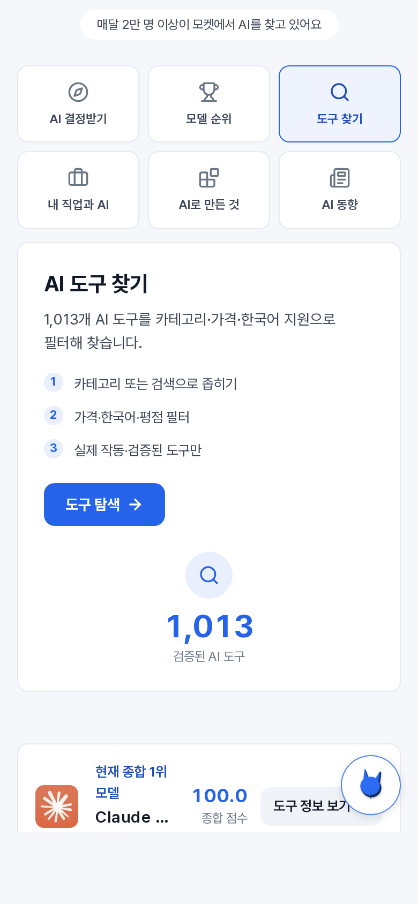
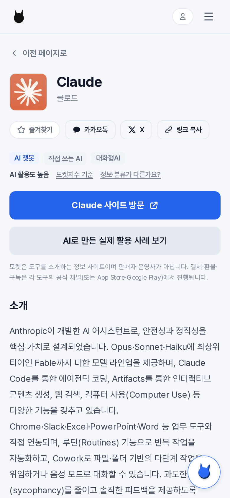

# Moket (moket.kr) — Media Kit

Operated by PrevitLAB · October 2026 · [Download PDF](media-kit.pdf)

## About
Moket is a Korean-language AI tool discovery site. We help Korean users find the right AI tool for a specific job or task, through verified tool pages (1,000+ tools), rankings, reviews, comparisons, how-to guides and series. Moket is an independent information site; we do not sell or operate the tools we list.

## Audience (GA4, last 30 days to 2026-10-16)
| Active users | Pageviews | Sessions | Users in Korea |
|---|---|---|---|
| ~29K | ~62K | ~37K | 83% |

- Devices: ~59% desktop, ~40% mobile.
- Most-read sections: rankings (~41% of views), tool pages (~30%), job-impact (~10%), verdicts/reviews (~9%), series (~3%).
- Figures are rounded.

## Search (Google Search Console, last 28 days)
About 24.9K impressions and 10.1K clicks, average position 2.4. A large share of this is branded search, so we treat it as reach among people already looking for Moket.

## Content formats
Dedicated tool pages with Korean-language summaries, pricing and fit; rankings; head-to-head comparisons; practical how-to articles; job- and task-based recommendation guides; multi-part series.

## Partnership model
A dedicated tool page on Moket, outbound visit-button click tracking via your affiliate link, and a Korean how-to article for the use case that fits your product. Revenue-share only: no posting fee.

## Screenshots (Korean UI)
 

## Contact
- Email: dev@previtlab.com
- Site: https://moket.kr
- Data source: GA4 + Google Search Console, queried 2026-10-16
